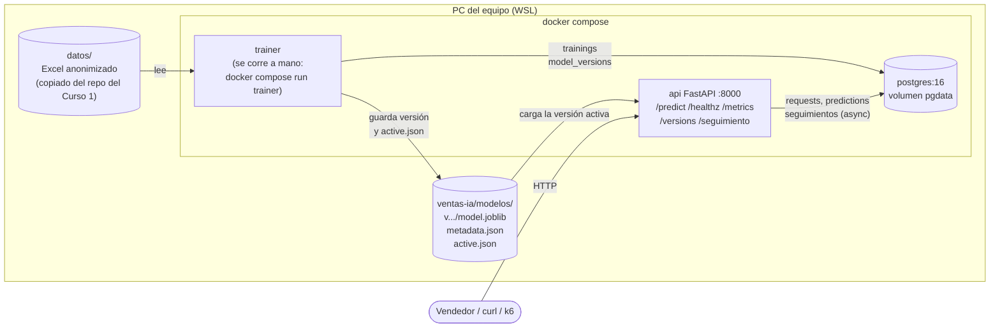
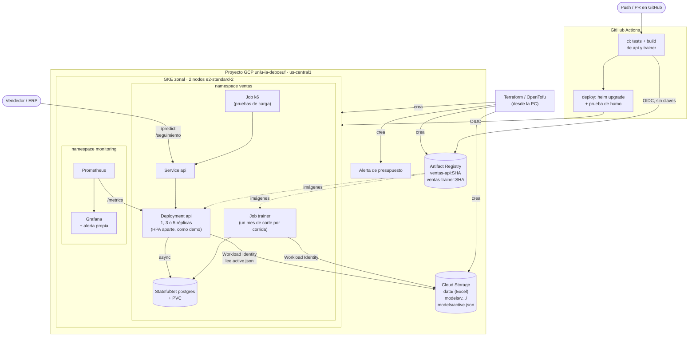

# Arquitectura · Accesorios que faltan

Las mismas figuras en PNG, para el informe: [local](img/arquitectura-local.png) · [Google Cloud](img/arquitectura-gcp.png).

El mismo código (`ventas-ia/`) corre en dos lugares. Cambia **dónde viven los datos y los modelos** y
**quién levanta los contenedores**, pero no el código: `DATA_URI` y `MODELS_URI` apuntan a una carpeta
en local y a `gs://` en la nube.

## 1. Local: Docker Compose (y k3d para probar Kubernetes)

Para probar los charts de Helm antes de pagar GKE se usa **k3d** (k3s dentro de Docker), como en la
clase 5: los mismos manifiestos que en la nube, con las imágenes importadas con `make k3d-images` y
los modelos en un volumen local.

## 2. Google Cloud: GKE

## Qué cambia entre los dos

| Pieza | Local | Google Cloud |
|---|---|---|
| Datos de entrenamiento | `datos/` en la PC | `gs://<bucket>/data/` |
| Versiones del modelo | `ventas-ia/modelos/` | `gs://<bucket>/models/` |
| Quién corre los contenedores | Docker Compose (o k3d) | GKE, con charts de Helm |
| Entrenamiento | `docker compose run trainer` | Job de Kubernetes |
| Base de datos | contenedor `postgres:16` con volumen | StatefulSet con PVC (disco persistente) |
| Credenciales | ninguna (todo local) | Workload Identity en pods, OIDC en CI: sin claves JSON |
| Imágenes | se construyen en la PC | CI las publica en Artifact Registry con el SHA |
| Observabilidad | `/metrics` a mano | Prometheus + Grafana |
| Infraestructura | — | Terraform / OpenTofu |

## Estado

| Pieza | Estado |
|---|---|
| API, trainer, Postgres y Docker Compose | Hecho (PR #1) |
| CI: tests y build de las dos imágenes | Hecho |
| Terraform: bucket, Workload Identity, node pool `e2-standard-2`, presupuesto | Pendiente |
| Charts de Helm (api, trainer, postgres) y `deploy.yml` | Pendiente |
| Prometheus/Grafana, k6 | Pendiente |
